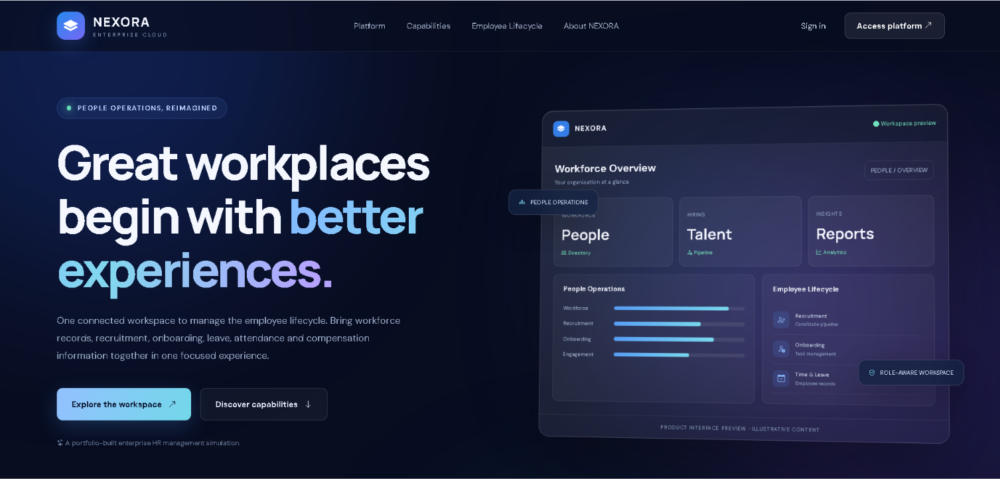
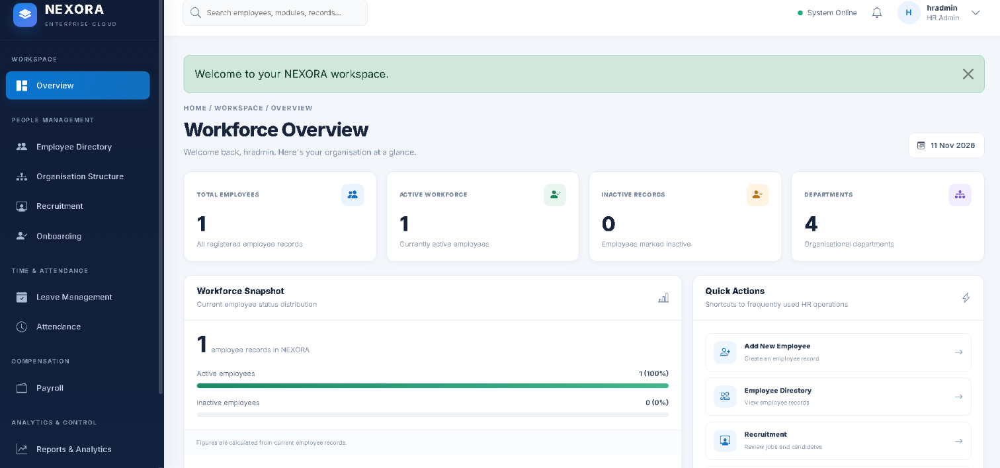
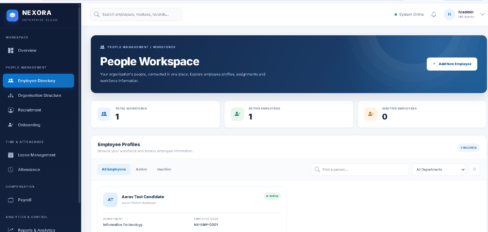
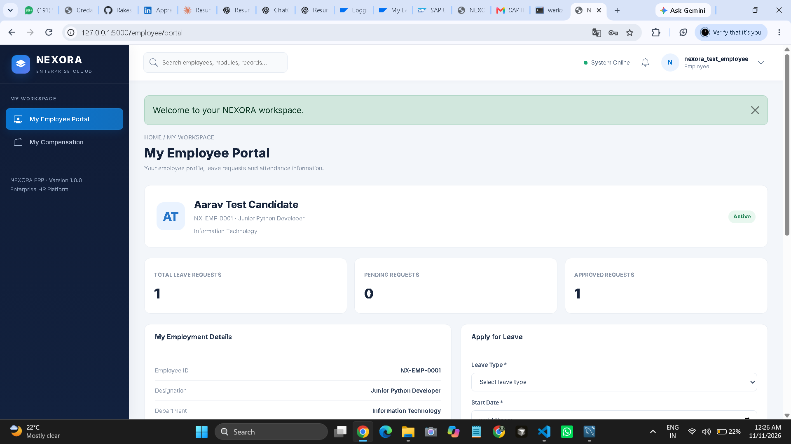

# NEXORA – HR Enterprise Resource Planning System

A web-based HR ERP simulation built using Python Flask and MySQL to demonstrate core Human Resource Management workflows through a modern enterprise-style interface.

## Project Overview

NEXORA is a standalone HR management application designed to bring essential HR operations into one unified platform. It demonstrates how employee information, recruitment, onboarding, attendance, leave management and payroll records can be managed through role-based workflows.

The interface takes inspiration from modern enterprise HR applications.

## Application Screenshots

### 1. Landing Page


### 2. HR Dashboard


### 3. Employee Directory


### 4. Employee Self-Service Portal


## Key Features

- **HR Dashboard:** Workforce overview and HR activity indicators.
- **Employee Management:** Create, update, view and deactivate employee records.
- **Organisation Management:** Department and organisational structure.
- **Recruitment:** Job openings, applications and recruitment status tracking.
- **Onboarding:** Employee onboarding records and task tracking.
- **Leave Management:** Leave applications, approvals and rejections.
- **Attendance Management:** Attendance record management.
- **Payroll Management:** Salary records with basic salary, allowances and deductions.
- **Employee Self-Service:** Employee portal for personal HR activities and compensation information.
- **Access Management:** User accounts and role-based access.

## Technology Stack

| Layer | Technologies |
|---|---|
| Backend | Python, Flask |
| Database | MySQL |
| Frontend | HTML, CSS, JavaScript |
| UI Framework | Bootstrap |
| Development Tools | VS Code, Git, GitHub |

## User Roles

- **HR Admin:** Manages HR operations, employee records and user access.
- **Manager:** Accesses relevant management workflows.
- **Employee:** Uses the self-service portal for employee-related activities.

## Project Structure

```text
hr_employee_management/
│
├── app.py
├── database.py
├── create_admin.py
├── requirements.txt
├── .env.example
├── .gitignore
│
├── static/
│   └── css/
│       └── nexora-theme.css
│
├── templates/
│   ├── base.html
│   ├── dashboard.html
│   ├── employees.html
│   ├── recruitment.html
│   ├── onboarding.html
│   ├── leave.html
│   ├── attendance.html
│   ├── payroll.html
│   ├── reports.html
│   ├── access.html
│   └── employee_portal.html
│
└── docs/
    └── screenshots/
```

## Installation and Setup

### 1. Clone the repository

```bash
git clone https://github.com/Rakeshmadival/nexora-hr-erp.git
cd nexora-hr-erp
```

### 2. Create a virtual environment

```bash
python -m venv venv
```

Activate it on Windows:

```powershell
venv\Scripts\activate
```

### 3. Install dependencies

```bash
pip install -r requirements.txt
```

### 4. Configure environment variables

Create a `.env` file in the project root using `.env.example` as a guide.

Configure your MySQL connection details and Flask secret key. Never commit your `.env` file or real credentials to GitHub.

### 5. Configure the database

Create a MySQL database named `hr_management`.

Ensure the required tables are created using the database schema for this project before starting the application.

### 6. Run the application

```bash
python app.py
```

Open your browser at:

```text
http://127.0.0.1:5000
```

## Project Documentation

The project includes supporting documentation:

- Business Requirements Document (BRD)
- Functional Requirements Specification (FRS)
- Test Cases

## Learning Outcomes

This project demonstrates practical understanding of:

- HR business processes and workflows.
- Employee lifecycle management.
- Role-based access control.
- Relational database design and SQL.
- Functional requirements and test case documentation.
- Translating business requirements into application features.

## Project Scope

NEXORA is an independent HR ERP simulation developed for learning and portfolio demonstration. It is not an official SAP product, SAP implementation or production-ready statutory payroll system.

## Author

**Rakesh Madival**

GitHub: https://github.com/Rakeshmadival

---

*Built to explore how technology can simplify and connect everyday HR operations.*